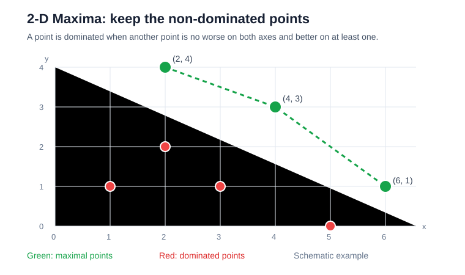
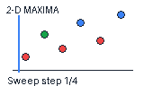
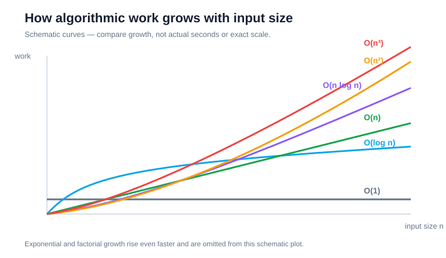

# 1. Foundations: from a problem to an analysed algorithm

**VU LMS index:** 2–7  
**Prerequisites:** basic programming, arrays, loops, and simple coordinate geometry.  
**Learning outcome:** explain what an algorithm is, model its cost, solve 2-D Maxima in two ways, and describe growth using asymptotic notation.

**New to a term?** See the [plain-language glossary](../docs/glossary.md).

This chapter is the starting point. Sorting, dynamic programming, greedy algorithms, and graph algorithms all depend on the ideas here.

## 1. Introduction

### What is an algorithm?

An algorithm is a finite, well-defined sequence of steps that transforms specified input into the required output. A Java program is one implementation of an algorithm; the algorithm itself is independent of Java, a compiler, or a particular computer.

A good algorithm description specifies:
- **Input:** what values are provided?
- **Output:** what result is required?
- **Steps:** how is the result produced?
- **Termination:** why does the process finish?

### Why study algorithm design?

When software becomes slow, changing syntax or buying faster hardware may not fix a poor underlying approach. A design that performs a **quadratic number of comparisons** can become impractical as input grows. For `n` input points, this means the comparison count can grow in proportion to `n²` (the square of the input size). Algorithm analysis helps compare designs before relying on machine-specific timings.

The course focuses on two resources:
- **Time:** how the number of basic operations grows.
- **Space:** how much additional memory an algorithm needs.

Real systems also care about I/O, networks, energy, cache behaviour, and maintainability. A mathematical model is a useful starting point, not the whole engineering decision.

### Algorithm design workflow

1. Specify the problem precisely.
2. Choose a straightforward correct approach.
3. Analyse its resource use.
4. Look for structure that avoids repeated work.
5. Implement and test the improved approach.

## 2. Model of computation: the RAM model

Different machines, languages, compilers, and operating systems have different speeds. To compare algorithms independently of those details, use an idealized **Random Access Machine (RAM)** model.

In the common **unit-cost RAM model** (each listed basic operation is counted as one step):
- one processor executes instructions sequentially;
- accessing an array element, assigning a variable, comparing two values, and basic arithmetic each take constant time;
- memory can be accessed directly by index;
- analysis counts how often basic operations occur as input grows.

This is an abstraction — a simplified model, not a claim about how every real computer behaves. Real machines have caches, different instruction costs, finite memory, and arbitrary-precision arithmetic may not take constant time.

**Do not confuse:** O(1) in the RAM model does not mean every real-world operation takes the same number of nanoseconds.

## 3. The motivating problem: 2-D Maxima

### Why does this problem exist?

Imagine comparing choices using two criteria:
- higher speed is better;
- lower price is better.

There may be no single choice that is best on both. But an option is clearly dominated if another option is at least as fast and at least as inexpensive, and strictly better in one criterion.

Represent the choices as points. Let x represent speed and y represent the amount of budget remaining (equivalently, negative price). Larger values are preferred on both axes.

### Formal definition

Given a finite set of points P in the plane, q **dominates** p when:
- q.x ≥ p.x;
- q.y ≥ p.y; and
- at least one inequality is strict.

A point is **maximal** if no other point in P dominates it.

Maximal does not mean that a point has the largest x and largest y simultaneously. Several points can be maximal because they represent different trade-offs (one may be better on x while another is better on y). Two points are **incomparable** when neither dominates the other.

Example:

| Point | Maximal? | Reason |
|---|---|---|
| (1, 2) | No | (3, 4) is better on both axes |
| (2, 5) | Yes | No other point is at least as good on both |
| (3, 4) | Yes | Higher x than (2, 5), but lower y |
| (4, 1) | Yes | Largest x, but low y |

The maximal set is {(2, 5), (3, 4), (4, 1)}.

## Why do we study 2-D Maxima?

The goal is not to memorize a special points problem. The goal is to learn how an algorithm designer thinks.

### A simple real-world picture

Suppose you are comparing products using two criteria: **performance** and **price**. Higher performance is better, but lower price is better. One product may be faster but more expensive; another may be slower but cheaper.

A product is a poor choice if another product is both at least as fast and no more expensive, and is strictly better in at least one of those ways. The products that are not beaten in this way form the set of **non-dominated choices** (also called the Pareto frontier).

To use the 2-D Maxima definition, represent each product as a point where:
- x = performance (higher is better);
- y = negative price (higher means cheaper).

Now, larger x and larger y are both better, matching the mathematical definition above.

### Why is this problem in an algorithms course?

It gives us a small, visual problem through which we can practise several important skills:

1. **Turn a real question into a precise problem.** What does it mean for one choice to be better than another?
2. **Start with a simple correct solution.** Compare every point with every other point.
3. **Measure the cost.** Understand why checking all pairs can require about n² comparisons.
4. **Find useful structure.** Notice that sorting points by x lets us avoid many repeated comparisons.
5. **Improve and justify the solution.** Use a sweep-line approach and explain why it returns the same maximal points in O(n log n) time.

The same non-dominated-choice idea appears in multi-objective optimization: for example, comparing designs by cost and quality, schedules by time and resource use, or services by latency and price. Real applications may have more than two criteria, but the 2-D version is easier to draw and reason about.

**The main lesson:** algorithm design is not just writing steps that produce the right answer. It is finding a way to produce that answer with less work as the input grows. 2-D Maxima is an introductory example that lets us see this improvement clearly.

## 4. The first solution: brute force

### Intuition

Follow the definition directly. For every candidate p, compare it with every other point q. If any q dominates p, discard p; otherwise keep it.

### Pseudocode

~~~text
MAXIMA(P):
    result = empty list

    for each point p in P:
        dominated = false

        for each point q in P:
            if q is different from p and q dominates p:
                dominated = true
                break

        if not dominated:
            add p to result

    return result
~~~

### Why does it take quadratic time?

For each of `n` points, the inner loop may inspect all `n` points. That gives up to `n × n` comparisons. This is called **quadratic growth** because the number of comparisons is proportional to the square of the input size. In practical terms, doubling `n` can make the comparison work about four times larger.

The worst case occurs when no point is dominated, for example points whose x increases while y decreases. The inner loop cannot stop early for any candidate.

Therefore:
- worst-case time: Θ(n²);
- additional memory: O(n) in the supplied Java implementation (it builds a unique working list and a result list);
- the nested-loop core itself needs O(1) extra space when reading the input directly.

## 5. Runtime analysis: why we need it and how to do it

### Why analyse runtime mathematically?

Wall-clock time changes with the processor, JVM, operating system, compiler optimizations, and system load. It helps when benchmarking a real implementation, but it is not a portable way to compare algorithm designs.

Mathematical analysis asks:

**As input size n grows, how does the amount of work grow?**

Use this sequence:

1. **Define input size.** For 2-D Maxima, n is the number of points.
2. **Choose a basic operation.** This is the repeated action being counted, such as comparing two points.
3. **Count executions.** Derive how many times that operation runs.
4. **Write a function.** Express the count in terms of n.
5. **Simplify.** Keep the dominant growth rate.

### Best, worst, and average case

- **Worst case:** maximum work over valid inputs of size n.
- **Best case:** minimum work over valid inputs of size n.
- **Average case:** expected work under a stated probability distribution. “Average” is ambiguous without specifying that distribution.

Worst-case analysis is useful because it gives a guarantee for all inputs of a given size.

### Count a simple loop

~~~text
for i = 1 to n:
    print(i)
~~~

The body runs n times. If the body takes constant time, T(n) = c·n + d, so the growth is Θ(n).

### Count nested loops

~~~text
for i = 1 to n:
    for j = 1 to n:
        compare(A[i], A[j])
~~~

The inner operation executes n times for each of n outer iterations:

T(n) = n × n = n²

Therefore the running time is Θ(n²).

### Apply this to 2-D Maxima

A handout-style illustrative cost model may count a constant number of point accesses per inner-loop comparison and a constant amount of work to output a maximal point. It can produce a function such as:

T(n) = 4n² + 2n

The constants depend on which primitive operations are counted. The n² term dominates as n grows, so the brute-force algorithm is Θ(n²).

**Important:** Big-O is not a stopwatch measurement. It describes how a cost function grows. Benchmarking is a separate experiment.

## 6. Improving the solution: plane sweep

A **sweep line** is an imaginary line that moves across the points in a chosen order. The algorithm processes points as the line passes them; it does not need to physically draw or move a line.

### The observation

Brute force asks every point about every other point. We can avoid many comparisons by sorting points by x-coordinate and processing them from left to right.

When a new point has y at least as high as the last candidate, that candidate is dominated: the new point is to its right and no lower.

Maintain only candidates whose y-values strictly decrease as x increases.

### Sweep animation

### Algorithm

1. Remove duplicate coordinates.
2. Sort by x ascending; break equal-x ties by y ascending.
3. Keep a stack of candidate maximal points.
4. For each point p, pop while the stack's last point has y ≤ p.y.
5. Push p.
6. The remaining stack contains the maximal points.

Sorting equal x-values by y ascending matters: a point with the same x but a larger y dominates the lower one. Duplicate coordinates are collapsed so the output contains one copy of each maximal coordinate.

### Pseudocode

~~~text
PLANE-SWEEP-MAXIMA(P):
    sort unique points by (x ascending, y ascending)
    stack = empty

    for each point p in sorted points:
        while stack is not empty and stack.last.y <= p.y:
            remove stack.last
        push p onto stack

    return stack
~~~

### Why is it correct?

After processing points in increasing x order, the stack has two properties:

1. x-coordinates increase from bottom to top.
2. y-coordinates strictly decrease from bottom to top.

Every popped point has x ≤ current.x and y ≤ current.y; because duplicates were removed, at least one inequality is strict. Thus the current point dominates every popped point.

A point still in the stack cannot be dominated by a later point: if a later point had at least as large a y-coordinate, the earlier point would have been popped. An earlier point cannot dominate a later one because its x-coordinate is smaller.

Therefore the final stack contains exactly the non-dominated points.

### Complexity

- Sorting: O(n log n).
- Sweep: O(n). Each point is pushed once and popped at most once.
- Total: O(n log n) time.
- Auxiliary space: O(n) for the sorted list and stack.

The improvement comes from sorting once and then scanning, rather than comparing every pair.

## 7. Asymptotic notation

**Asymptotic notation** describes how work grows as the input becomes large. It helps compare the growth of algorithms without focusing on exact seconds, small constant differences, or the particular computer being used.

| Notation | Meaning | Informal reading |
|---|---|---|
| O(g(n)) | Asymptotic upper bound | No faster than g, up to a constant factor |
| Ω(g(n)) | Asymptotic lower bound | At least as fast as g, up to a constant factor |
| Θ(g(n)) | Tight asymptotic bound | Same growth order as g |

For example, 4n² + 2n is Θ(n²), and therefore also O(n²) and Ω(n²).

### Common growth rates

From slower-growing to faster-growing for sufficiently large n:

O(1), O(log n), O(n), O(n log n), O(n²), O(n³), O(2ⁿ), O(n!).

### Simplify a function

For T(n) = 5n³ + 10n² + 8:
1. Ignore constant multipliers.
2. Ignore lower-order terms.
3. Keep the **dominant term** — the term that grows fastest as `n` increases.

Result: Θ(n³).

## 8. Common mistakes

- Treating measured seconds as mathematical complexity.
- Saying O(n²) means the algorithm always performs exactly n² operations.
- Assuming there can only be one maximal point.
- Forgetting the strict part of dominance: identical points do not dominate each other.
- Claiming the sweep is O(n) while forgetting sorting costs O(n log n).
- Sorting by x only and ignoring equal-x tie handling.

## 9. Check your understanding

Try these before looking at the answers.

1. Can an input contain more than one maximal point? Give an example.
2. Construct n points that make the brute-force algorithm inspect all pairs.
3. Why does runtime analysis use n rather than coordinate magnitudes?
4. What does the RAM model assume about a basic comparison?
5. Why is the sweep O(n log n), not O(n)?
6. Why must equal-x points be ordered carefully?
7. Simplify 7n² + 3n + 20 using Θ notation.

### Answers

1. Yes. (1, 5), (2, 4), and (3, 1) are pairwise incomparable.
2. Use (1,n), (2,n−1), …, (n,1). No point dominates another.
3. Input size is the number of points; coordinate magnitude does not determine how many points are processed.
4. The unit-cost RAM model treats a basic comparison as constant time.
5. Sorting dominates the linear scan.
6. With equal x, the point with larger y dominates one with lower y. Increasing y order lets the stack remove the lower point.
7. Θ(n²).

## Java implementation

The Maven project contains:
- **BruteForceMaxima** — direct implementation of the definition.
- **PlaneSweepMaxima** — sorting and monotonic stack.
- **MaximaDemo** — runs both approaches.
- JUnit tests for empty input, one point, duplicates, equal coordinates, and a representative set.

Run **mvn test** from the repository root.
