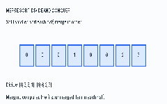

# 2. Sorting and Selection

**VU LMS index:** 8–16  
**Prerequisites:** loops, arrays, recursion, and runtime analysis.

**New to a term?** See the [plain-language glossary](../docs/glossary.md).

Sorting arranges values in an agreed order. It is useful for ranking, reporting, duplicate detection, searching, and preparing data for other algorithms. Selection asks for one ranked item (such as a median) without necessarily sorting every value.

**Divide and conquer** means splitting a problem into smaller versions, solving those smaller problems, and combining their results. Merge Sort and Quick Sort use this general idea.

## 1. Merge Sort

### Why does it exist?

A simple nested-loop sort can take Θ(n²) comparisons. Merge Sort uses divide and conquer to reduce the growth to Θ(n log n).

### The idea

1. Split the array into two halves.
2. Recursively sort each half.
3. Merge the two sorted halves by repeatedly taking the smaller front item.

Input [8, 3, 5, 1]:

- Divide: [8, 3] and [5, 1].
- Divide again: [8], [3], [5], [1].
- Merge: [3, 8] and [1, 5].
- Final merge: [1, 3, 5, 8].

~~~text
MERGE-SORT(A):
    if length(A) <= 1:
        return A
    split A into left and right
    left = MERGE-SORT(left)
    right = MERGE-SORT(right)
    return MERGE(left, right)
~~~

MERGE compares the first unmerged item in each half, copies the smaller item to output, then appends what remains.

## 2. Merge Sort analysis

T(n) = 2T(n/2) + Θ(n)

There are two recursive calls on halves of the input, and merging costs Θ(n).

At each level of the **recursion tree** (a picture of the smaller calls made by recursive steps), total merge work is Θ(n). The number of levels is `log₂ n`: this is how many times `n` can be halved before reaching one item.

Therefore T(n) = Θ(n log n).

- Best, average, and worst time: Θ(n log n).
- Auxiliary space for the usual array implementation: Θ(n).
- **Stable:** yes. A stable sort keeps equal-valued items in their original relative order; Merge Sort does this when equal values are taken from the left half first.
- **In-place:** no. An in-place algorithm uses only a constant amount of extra working memory; the usual array-based Merge Sort needs a temporary array.

## 3. Recurrences and selection

A **recurrence** is an equation that describes running time using the costs of smaller inputs. For example, `T(n) = 2T(n/2) + Θ(n)` says that the algorithm solves two half-sized problems and then does linear work to combine them.

| Recurrence | Typical result | Example |
|---|---|---|
| T(n) = T(n−1) + Θ(1) | Θ(n) | reduction by one |
| T(n) = T(n/2) + Θ(1) | Θ(log n) | binary search |
| T(n) = 2T(n/2) + Θ(n) | Θ(n log n) | Merge Sort |
| T(n) = 2T(n/2) + Θ(1) | Θ(n) | balanced binary recursion with constant combine work |

These examples assume suitable base cases and regular input sizes. Draw a recurrence tree or use the Master Theorem only after identifying the recursive subproblems and non-recursive work.

### Selection problem

Given n values and an integer k, return the kth smallest value. The 3rd smallest value in [8, 2, 5, 1, 7] is 5.

Sorting first costs O(n log n), but selection does not require a fully sorted array.

## 4. Selection: kth smallest and median

A **pivot** is the value chosen to divide the array. **Partitioning** rearranges values around that pivot so the required smaller and larger values end up on the appropriate sides. The pivot's final index tells us which part can contain the kth item.

**Quickselect:**
1. Choose a pivot.
2. Partition the array.
3. If the pivot is at index k (zero-based), return it.
4. Otherwise continue only in the partition containing k.

Expected time with randomized pivots: O(n). Worst case: O(n²), when every pivot leaves a partition of size n−1.

The deterministic median-of-medians technique groups values, finds group medians, selects a pivot from those medians, and guarantees a sufficiently balanced partition. It gives worst-case O(n), but has larger constant overhead and is more involved to implement.

**Do not confuse:** finding the median is a selection problem; sorting the entire input is one possible but not always necessary solution.

## 5. Binary heaps

A **binary heap** is a complete binary tree: every level is full except possibly the last, and the last level is filled from left to right. It also follows a **heap-order property**, which controls how each parent compares with its children.

For a **max-heap**, every parent is at least as large as its children. The largest value is at the root.

In a zero-based array:
- parent(i) = floor((i − 1) / 2)
- left(i) = 2i + 1
- right(i) = 2i + 2

A heap is not a binary search tree. Siblings and subtrees are not fully sorted.

| Operation | Max-heap cost |
|---|---:|
| Read maximum | O(1) |
| Insert | O(log n) |
| Extract maximum | O(log n) |
| Build heap from an array | O(n) |

Bottom-up BuildHeap is O(n), not O(n log n), because most nodes are close to the leaves and need only a little **sift-down** work. Sift-down means moving a value down the heap until the parent-child ordering is restored.

## 6. Heap Sort

1. Build a max-heap.
2. Swap the root (maximum) with the last active item.
3. Shrink the heap by one.
4. Sift down the new root.
5. Repeat until one item remains.

- Worst-case time: O(n log n).
- Auxiliary space: O(1) for the standard in-place array implementation.
- Stable: no.

## 7. Quick Sort

Quick Sort partitions around a pivot, then sorts the resulting partitions recursively.

~~~text
QUICK-SORT(A, low, high):
    if low < high:
        pivotIndex = PARTITION(A, low, high)
        QUICK-SORT(A, low, pivotIndex - 1)
        QUICK-SORT(A, pivotIndex + 1, high)
~~~

Unlike Merge Sort, its main work happens during partitioning and it does not merge sorted halves afterward.

## 8. Quick Sort analysis

| Case | Time | Why |
|---|---:|---|
| Best / balanced | Θ(n log n) | Partitions are similar in size |
| Expected with randomized pivot | Θ(n log n) | Expected partitions are sufficiently balanced |
| Worst | Θ(n²) | Pivot repeatedly creates sizes 0 and n−1 |

Partitioning a range of n items costs Θ(n). A balanced recurrence is T(n)=2T(n/2)+Θ(n), while the worst recurrence is T(n)=T(n−1)+Θ(n).

Randomized pivots reduce the chance of consistently bad partitions but do not remove the theoretical worst case.

## 9. Sorting lower bounds and Counting Sort

### Why a lower bound?

An **upper bound** describes a limit on the work of a particular algorithm. A **lower bound** says that any algorithm in a specified model must do at least that much work in the relevant case.

For comparison sorting, the **decision-tree** argument gives Ω(n log n) comparisons in the worst case. Imagine a yes/no question tree: each comparison has two possible outcomes, and the tree must distinguish all `n!` possible input orders. It therefore needs at least `n!` leaves, giving a height of at least `log₂(n!) = Ω(n log n)`. 

This bound applies to comparison-based sorting, not every possible sorting method.

### Counting Sort

Counting Sort is useful when values are integers from a reasonably small range.

1. Count occurrences of each key.
2. Convert counts to **cumulative positions**: running totals that tell where each key's values belong in the output array.
3. Place values into the output array.

- Time: O(n + k), where k is the key range size.
- Space: O(n + k) for a stable output-array version.
- It is not comparison-based.
- It becomes impractical when k is extremely large relative to n.

For negative integers, offset each value by the minimum key before indexing the count array.

## 10. Bucket Sort and Radix Sort

### Bucket Sort

Distribute values into buckets, sort each bucket, then concatenate them. Its expected linear behaviour relies on assumptions such as values being spread reasonably evenly across the bucket range. In other words, no single bucket should receive nearly all the values. A bad distribution can put most values in one bucket and degrade performance.

### Radix Sort

Sort keys digit by digit, using a **stable** sort for each digit. For n values, d digits, and digit range k, a typical implementation takes O(d(n+k)) time.

Radix Sort is not automatically faster for every input: key representation, number of digits, and digit-processing cost matter.

## Comparison at a glance

| Algorithm | Worst-case time | Extra space (typical) | Stable? |
|---|---:|---:|---|
| Merge Sort | O(n log n) | O(n) | Yes |
| Quick Sort | O(n²) | O(log n) average stack; O(n) worst | No |
| Heap Sort | O(n log n) | O(1) | No |
| Counting Sort | O(n + k) | O(n + k) | Yes, with cumulative placement |
| Bucket Sort | O(n²) in a common worst case | O(n + k) | Depends on bucket sort |
| Radix Sort | O(d(n + k)) | O(n + k) | Requires stable digit sort |

## Self-check

1. Why does Merge Sort need a merge step?
2. What does each level of the Merge Sort recursion tree cost?
3. Why can Quick Sort be quadratic?
4. Why does Quickselect inspect only one partition after partitioning?
5. Why is BuildHeap O(n), while repeated insertion is O(n log n)?
6. Why does the comparison-sorting lower bound not rule out Counting Sort?
7. What assumption makes Bucket Sort's expected time attractive?
8. Why must the digit sort inside Radix Sort be stable?

## Java coverage

The Java project includes Merge Sort, Quick Sort, Heap Sort, and Counting Sort in the SortingAlgorithms class. Median selection and the heap data structure are explained here; their dedicated implementations are further exercises, not claimed as completed code.
