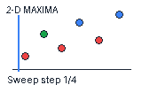
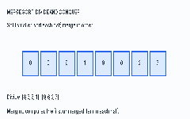

# Algorithms, Made Understandable

> Understand the idea. Follow the steps. Implement it yourself.

A visual, beginner-first companion to Virtual University of Pakistan's **CS502 — Fundamentals of Algorithms**. The course order is preserved, but explanations are organized by concepts so repeated lectures do not create duplicate pages.

The goal is not to collect the largest number of solutions. It is to make each topic understandable enough that a learner can continue independently.

[Start here](#start-here) · [Course index](#course-index-vu-lms-order) · [Plain-language glossary](docs/glossary.md) · [Run Java examples](#run-the-java-examples) · [Sources](SOURCES.md)

## The problem this repository solves

Algorithm learning material is often split between lecture notes, pseudocode, code snippets, and separate visual tools. Beginners must connect these pieces themselves:

- Definitions explain what an algorithm is, but may not explain why a problem matters.
- Pseudocode lists steps, but does not always make state changes obvious.
- Code-first solutions hide the reasoning behind implementation choices.
- A Big-O label gives a result without showing how it was derived.
- A list of algorithms does not give learners a useful order to follow.

This repository brings those steps together: **problem → motivation → intuition → worked example → visualization where useful → pseudocode → Java → complexity → limitations → self-check**.

## Start here

1. Read [How to learn from this repository](docs/how-to-learn.md).
2. Keep the [plain-language glossary](docs/glossary.md) nearby when you meet an unfamiliar term.
3. Study [Foundations: algorithms, the RAM model, 2-D Maxima, runtime analysis, and asymptotic notation](01-foundations/README.md).
4. Run the 2-D Maxima demonstration and tests.
5. Continue to [Sorting and Selection](02-sorting-and-selection/README.md).

**Suggested background:** basic Java syntax, variables, loops, methods, arrays, and simple mathematical notation. The foundation guide introduces the analysis ideas used later.

## Course index (VU LMS order)

The table preserves the order and wording of the 48 items in the supplied LMS index. Repeated lecture topics intentionally point to one shared explanation rather than duplicating content.

| LMS index | University topic and learning guide |
|---:|---|
| **Foundations** | **Lectures 2–7** |
| 1 | Welcome Note — [How to learn](docs/how-to-learn.md) |
| 2 | Introduction — [Algorithm foundations](01-foundations/README.md#1-introduction) |
| 3 | Model of computation, 2-D maxima — [RAM model and 2-D Maxima](01-foundations/README.md#2-model-of-computation-the-ram-model) |
| 4 | Analysis of 2-D Maxima — [Brute force](01-foundations/README.md#4-the-first-solution-brute-force) |
| 5 | Runtime analysis — [Why and how runtime is analysed](01-foundations/README.md#5-runtime-analysis-why-we-need-it-and-how-to-do-it) |
| 6 | 2-D maxima: sweep line algorithm — [Plane sweep](01-foundations/README.md#6-improving-the-solution-plane-sweep) |
| 7 | Asymptotic Notation — [Growth rates](01-foundations/README.md#7-asymptotic-notation) |
| **Sorting and Selection** | **Lectures 8–17** |
| 8 | Asymptotic notation, merge sort — [Merge Sort](02-sorting-and-selection/README.md#1-merge-sort) |
| 9 | Analysis of Merge Sort — [Merge Sort analysis](02-sorting-and-selection/README.md#2-merge-sort-analysis) |
| 10 | Solving recurrence relations, median selection — [Recurrences and selection](02-sorting-and-selection/README.md#3-recurrences-and-selection) |
| 11 | Median selection - partitioning algorithm — [Partition-based selection](02-sorting-and-selection/README.md#4-selection-kth-smallest-and-median) |
| 12 | Analysis of median selection, binary heaps, sorting — [Binary heaps](02-sorting-and-selection/README.md#5-binary-heaps) |
| 13 | Heap sort, analysis of heap sort — [Heap Sort](02-sorting-and-selection/README.md#6-heap-sort) |
| 14 | Quick sort — [Quick Sort](02-sorting-and-selection/README.md#7-quick-sort) |
| 15 | Analysis of quick sort — [Quick Sort analysis](02-sorting-and-selection/README.md#8-quick-sort-analysis) |
| 16 | Lower bounds for sorting, Linear time sorting, counting sort — [Lower bounds and Counting Sort](02-sorting-and-selection/README.md#9-sorting-lower-bounds-and-counting-sort) |
| 17 | Bucket sort, radix sort, dynamic programming, Fibonacci sequence — [Bucket and Radix Sort](02-sorting-and-selection/README.md#10-bucket-sort-and-radix-sort) · [Fibonacci](03-dynamic-programming/README.md#1-fibonacci) |
| **Dynamic Programming** | **Lectures 18–23** |
| 18 | Dynamic programming - edit distance — [Edit Distance](03-dynamic-programming/README.md#2-edit-distance) |
| 19 | Dynamic programming - edit distance algorithm — [Edit Distance algorithm](03-dynamic-programming/README.md#2-edit-distance) |
| 20 | Dynamic programming - chain matrix multiply — [Matrix-chain multiplication](03-dynamic-programming/README.md#3-matrix-chain-multiplication) |
| 21 | Dynamic programming - chain matrix multiply — [Matrix-chain walkthrough](03-dynamic-programming/README.md#3-matrix-chain-multiplication) |
| 22 | Dynamic programming - 0/1 knapsack — [0/1 Knapsack](03-dynamic-programming/README.md#4-01-knapsack) |
| 23 | Dynamic programming - 0/1 knapsack — [0/1 Knapsack implementation](03-dynamic-programming/README.md#4-01-knapsack) |
| **Greedy Algorithms** | **Lectures 24–28** |
| 24 | Greedy algorithms - coin change problem — [Coin change](04-greedy-algorithms/README.md#1-coin-change) |
| 25 | Greedy algorithms - Huffman encoding — [Huffman encoding](04-greedy-algorithms/README.md#2-huffman-encoding) |
| 26 | Greedy algorithms - Huffman encoding — [Huffman construction](04-greedy-algorithms/README.md#2-huffman-encoding) |
| 27 | Greedy algorithms - Activity scheduling — [Activity selection](04-greedy-algorithms/README.md#3-activity-selection) |
| 28 | Greedy algorithms - fractional knapsack, Graphs - definitions — [Fractional knapsack](04-greedy-algorithms/README.md#4-fractional-knapsack) · [Graph vocabulary](05-graphs/README.md#1-graph-vocabulary) |
| **Graphs** | **Lectures 29–43** |
| 29 | Graphs - representations, traversal — [Graph representations](05-graphs/README.md#2-graph-representations) |
| 30 | Graphs - breadth-first search, generic traversal algorithms — [BFS](05-graphs/README.md#3-breadth-first-search-bfs) |
| 31 | Graphs - generic traversal algorithms — [General traversal pattern](05-graphs/README.md#4-the-general-traversal-pattern) |
| 32 | Graphs - depth-first search, timestamp structure — [DFS and timestamps](05-graphs/README.md#5-depth-first-search-dfs-and-timestamps) |
| 33 | Graphs - cycles, topological sorting — [Cycles and topological sorting](05-graphs/README.md#6-cycles-and-topological-order) |
| 34 | Graphs - strong components — [Strongly connected components](05-graphs/README.md#7-strongly-connected-components) |
| 35 | Graphs - strong components, minimum spanning tree (MST) — [SCC](05-graphs/README.md#7-strongly-connected-components) · [MST](05-graphs/README.md#8-minimum-spanning-trees) |
| 36 | Graphs - MST: generic approach — [MST strategy](05-graphs/README.md#8-minimum-spanning-trees) |
| 37 | Graphs - MST: Kruskal's algorithm — [Kruskal](05-graphs/README.md#9-kruskals-algorithm) |
| 38 | Graphs - MST: Prim's algorithm — [Prim](05-graphs/README.md#10-prims-algorithm) |
| 39 | Graphs - shortest paths — [Shortest paths](05-graphs/README.md#11-shortest-paths) |
| 40 | Graphs - Dijkstra's algorithm — [Dijkstra](05-graphs/README.md#12-dijkstras-algorithm) |
| 41 | Graphs - Dijkstra's algorithm, Bellman-Ford algorithm — [Dijkstra](05-graphs/README.md#12-dijkstras-algorithm) · [Bellman-Ford](05-graphs/README.md#13-bellman-ford) |
| 42 | Graphs - all-pairs shortest path, Floyd-Warshall's algorithm — [Floyd-Warshall](05-graphs/README.md#14-floyd-warshall) |
| 43 | Graphs - Floyd-Warshall algorithm — [Floyd-Warshall walkthrough](05-graphs/README.md#14-floyd-warshall) |
| **Complexity Theory** | **Lectures 44–46** |
| 44 | Complexity theory - classes P, NP — [P and NP](06-complexity-theory/README.md#1-p-and-np) |
| 45 | Complexity theory - Reductions, graph coloring — [Reductions and graph coloring](06-complexity-theory/README.md#2-polynomial-time-reductions) |
| 46 | Complexity theory - Boolean satisfiability, independent sets — [SAT and independent set](06-complexity-theory/README.md#3-classic-decision-problems) |
| **Revision and Assessment** | **Lectures 47–48** |
| 47 | UVAS Spring 2010 (Lecture 1-27) — [Revision guide](07-revision/README.md) |
| 48 | Pre-Assessment — [Self-assessment](07-revision/README.md#self-assessment) |
## Visual learning

### 2-D Maxima — keeping only non-dominated points

The animation shows the sweep line moving from left to right and removes candidates that are dominated by the current point.

### Merge Sort — divide, then merge

Follow the array as it is split into smaller parts and merged into sorted order.

Static diagrams are used for relationships and definitions; animations are reserved for processes where state changes are easier to understand over time.

## Run the Java examples

**Requirements:** JDK 17 or newer and Maven 3.9 or newer.

Run the tests:

~~~bash
mvn test
~~~

Run the 2-D Maxima demonstration:

~~~bash
mvn -q -DskipTests package
java -cp target/classes io.github.sabeerwaqas.algorithms.foundations.MaximaDemo
~~~

The current Java examples cover 2-D Maxima, four sorting algorithms, four dynamic-programming examples, activity selection, BFS, DFS, and Dijkstra. The guides state clearly where further implementations are still needed.

## Project status

The foundation chapter is the first complete learning unit. The other chapters provide course-aligned explanations, examples, algorithm steps, conditions, complexity notes, and self-checks. Not every described algorithm has a Java implementation yet; coverage is expanded incrementally rather than pretending all code is complete.

## Learning principles

- Explanations, examples, diagrams, animations, and code are independently written.
- Every algorithm guide explains the problem before presenting the solution.
- Complexity claims include their assumptions.
- A visualization must teach a concept, not decorate the page.
- An implementation is only considered complete when edge cases are tested.

## Academic integrity and scope

This repository follows the CS502 topic order but does not reproduce VU handout pages, highlighted notes, or answer keys. Use your authorized LMS access for the original course material. This is an independent learning companion, not an official VU publication.

See [SOURCES.md](SOURCES.md) for references and [CONTRIBUTING.md](CONTRIBUTING.md) for contribution standards.
